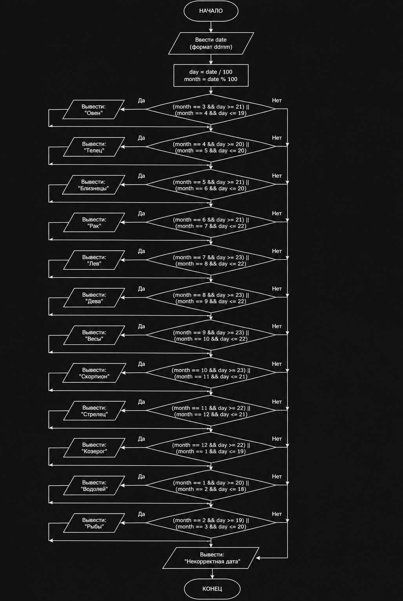

# Лабораторная работа

## Вариант 9

### Условие задачи

Составить программу, которая в зависимости от даты, введенной одним числом `ddmm`, где `dd` — число, `mm` — месяц, выводит на экран соответствующий знак Зодиака.

## Алгоритм

1. Ввести дату одним числом в формате `ddmm`.
2. Выделить день:
   
   `day = date / 100`

3. Выделить месяц:
   
   `month = date % 100`

4. С помощью условных операторов определить диапазон дат.
5. Вывести соответствующий знак Зодиака.

## Блок-схема



## Код программы

```c
#include <stdio.h>

int main()
{
    int date, day, month;

    printf("Введите дату в формате ddmm: ");
    scanf("%d", &date);

    day = date / 100;
    month = date % 100;

    if ((month == 3 && day >= 21) || (month == 4 && day <= 19))
        printf("Знак Зодиака: Овен\n");

    else if ((month == 4 && day >= 20) || (month == 5 && day <= 20))
        printf("Знак Зодиака: Телец\n");

    else if ((month == 5 && day >= 21) || (month == 6 && day <= 20))
        printf("Знак Зодиака: Близнецы\n");

    else if ((month == 6 && day >= 21) || (month == 7 && day <= 22))
        printf("Знак Зодиака: Рак\n");

    else if ((month == 7 && day >= 23) || (month == 8 && day <= 22))
        printf("Знак Зодиака: Лев\n");

    else if ((month == 8 && day >= 23) || (month == 9 && day <= 22))
        printf("Знак Зодиака: Дева\n");

    else if ((month == 9 && day >= 23) || (month == 10 && day <= 22))
        printf("Знак Зодиака: Весы\n");

    else if ((month == 10 && day >= 23) || (month == 11 && day <= 21))
        printf("Знак Зодиака: Скорпион\n");

    else if ((month == 11 && day >= 22) || (month == 12 && day <= 21))
        printf("Знак Зодиака: Стрелец\n");

    else if ((month == 12 && day >= 22) || (month == 1 && day <= 19))
        printf("Знак Зодиака: Козерог\n");

    else if ((month == 1 && day >= 20) || (month == 2 && day <= 18))
        printf("Знак Зодиака: Водолей\n");

    else if ((month == 2 && day >= 19) || (month == 3 && day <= 20))
        printf("Знак Зодиака: Рыбы\n");

    else
        printf("Некорректная дата\n");

    return 0;
}
```

## Проверка программы

### Пример 1

Ввод:

```text
1508
```

Результат:

```text
Знак Зодиака: Лев
```

### Пример 2

Ввод:

```text
2503
```

Результат:

```text
Знак Зодиака: Овен
```

### Пример 3

Ввод:

```text
2512
```

Результат:

```text
Знак Зодиака: Козерог
```

## Вывод

В ходе выполнения работы была разработана программа на языке C, которая определяет знак Зодиака по введенной дате. Для выделения дня и месяца использовались операции целочисленного деления и получения остатка от деления. Для определения знака Зодиака использовалась конструкция `if - else if`.

## Разработчик

Каверин Максим, группа БИЦТ-262
